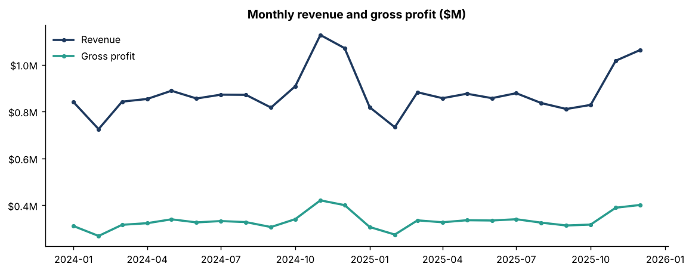
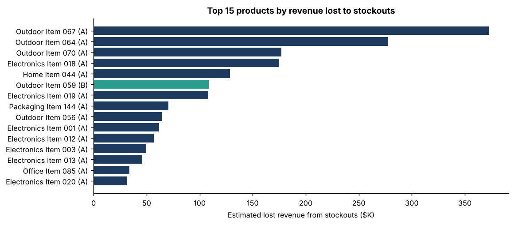
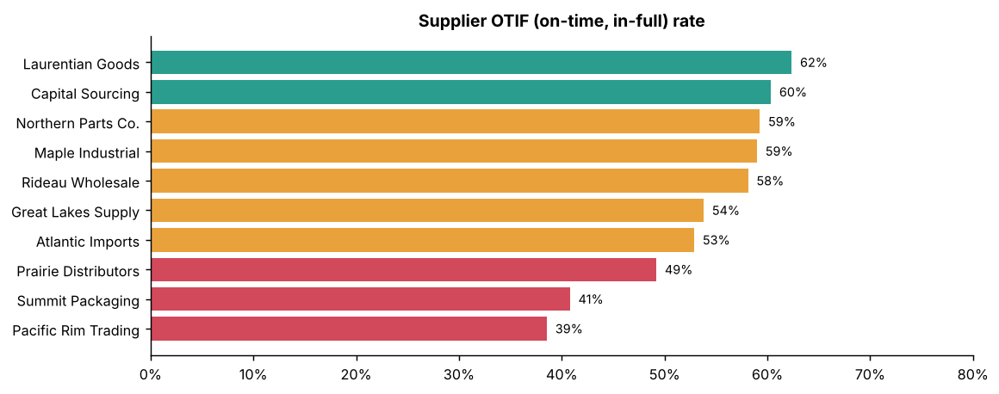
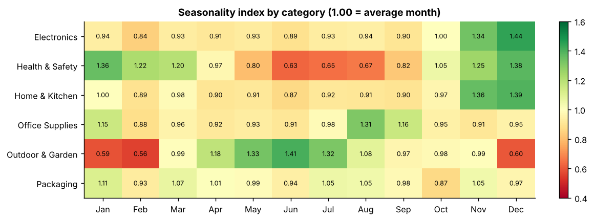
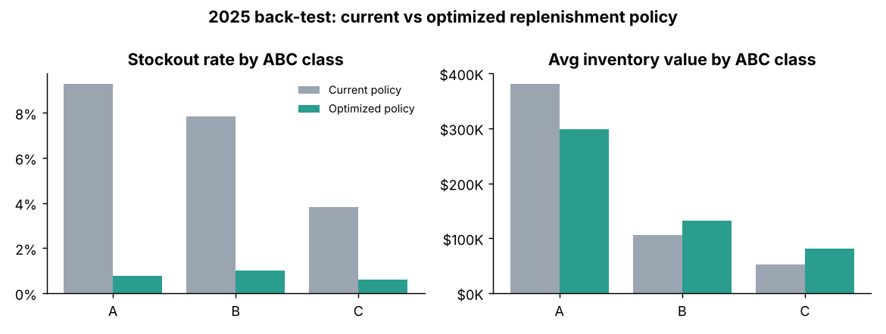
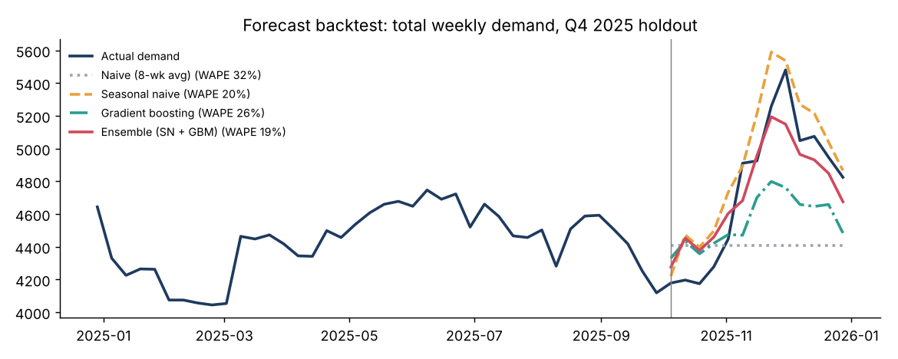

# Supply Chain & Inventory Optimization

     

> **TL;DR** — Diagnosed **$2.34M of revenue lost to stockouts**, built a demand forecast (14% WAPE on top products), and designed a replenishment policy that back-tests to **−88% stockouts with 4.8% less inventory**.

End-to-end inventory analytics for *NorthStar Supply Co.*, a fictional Canadian
distributor with 150 products, 10 suppliers and two years of daily operations
(133K sales transactions, 110K daily inventory snapshots, 2K purchase orders).
The project diagnoses why the company is losing sales to stockouts, builds a
demand forecast, designs a new replenishment policy, and **back-tests that
policy against what actually happened in 2025**.

> The data is synthetic, generated by `src/01_generate_data.py`. It runs a real
> day-by-day inventory simulation with a deliberately flawed ordering policy,
> so stockouts, excess stock and late suppliers *emerge* from the data rather
> than being hard-coded.



---

## Key findings

**1. Stockouts are getting worse and are hiding demand growth.**
Customer demand grew 1.7% in 2025, but units sold *fell* 1.4%. The share of
SKU-days with zero stock rose from 5.0% to 6.3%. Over two years an estimated
**$2.34M of revenue (≈11% of sales) was lost to stockouts**.

**2. The most important products run out the most.**
36 "A" products (24% of SKUs) generate 80% of revenue, yet they have the
*highest* stockout rate (8.7% vs 3.2% for C items) and account for 83% of lost
revenue. Ten products alone account for two-thirds of it. The old reorder
points were set once from Q1 2024 demand and never refreshed.



**3. Two suppliers are unreliable, and one is a major spend.**
Overall OTIF (on-time, in-full) is 54%. Pacific Rim Trading (39% OTIF) delivers
4.6 days later than promised on average with a 7-day standard deviation;
Summit Packaging (41% OTIF) carries $1.6M of spend. Reorder points were based on
*promised* lead times, so every late delivery became a stockout risk.



**4. Demand is strongly seasonal and the seasonality is forecastable.**
Electronics and Home & Kitchen peak 35 to 45% above average in Nov and Dec,
Outdoor & Garden swings from 0.56x in February to 1.41x in June.



**5. A data-driven policy would have cut stockouts by ~88% while holding *less* inventory.**
Simulated on actual 2025 demand with replayed supplier behaviour:

| Metric (2025) | Current policy | Optimized policy | Change |
|---|---|---|---|
| Stockout rate (% of SKU-days) | 6.3% | 0.8% | −88% |
| Fill rate | 92.8% | 99.1% | +6.2 pts |
| Revenue lost to stockouts | $1.31M | $0.09M | **−$1.22M** |
| Average inventory value | $538K | $512K | −4.8% |
| Purchase orders placed | 1,070 | 894 | −16% |

The policy shifts inventory toward A items' safety stock and away from the
oversized orders on slow movers. C-item inventory rises somewhat, mainly
because of supplier minimum order quantities, which is the next lever to negotiate.



---

## Methodology

**Data cleaning** (`02_clean_data.py`): removed 531 duplicate transactions,
standardised 2,665 mixed-format dates, removed 60 invalid negative quantities
and 8 extreme outliers, imputed 400 missing prices, fixed inconsistent
category labels. Every fix is logged to `outputs/cleaning_report.csv`.

**SQL** (`sql/`): star schema (2 dimensions, 3 facts) loaded into SQLite;
nine analysis queries using CTEs and window functions (`LAG`, running `SUM() OVER`)
for MoM/YoY growth, ABC classification, supplier scorecard, stockout cost,
turnover, excess stock and seasonality.

**ABC-XYZ classification** (`04_eda_abc.py`): ABC on cumulative revenue
(80/95% cut-offs); XYZ on the coefficient of variation of weekly demand.
Service levels are set by class: A 98%, B 95%, C 90%.

**Demand forecasting** (`05_forecast.py`): forecasts *unconstrained demand*
(including demand lost during stockouts), not sales. Training on sales would
teach the model to under-forecast exactly the products that already run out.
Four models were back-tested on a 13-week Q4 2025 holdout (holiday peak):

| Model | WAPE (all) | WAPE (A items) | Bias |
|---|---|---|---|
| Naive (8-week average) | 31.8% | 27.1% | −7.2% |
| Seasonal naive | 19.5% | 15.3% | +3.6% |
| Gradient boosting (global) | 26.3% | 19.9% | −5.0% |
| **Ensemble (seasonal naive + GBM)** | **18.8%** | **14.0%** | **−0.7%** |

Gradient boosting alone underperformed because two years of history contain
only one holiday season to learn from, a useful lesson in not reaching for ML
by default. The ensemble was selected and produces the Q1 2026 forecast.



**Replenishment policy** (`06_inventory_policy.py`):

- Safety stock = z × √(LT × σ_d² + d² × σ_LT²), covering demand *and* lead-time variability
- Reorder point = d × LT + safety stock, using **actual** supplier lead times
- Order quantity = max(EOQ, supplier MOQ), with EOQ = √(2DS / H)
- Parameters refreshed monthly using only data available at that date (no look-ahead)

The back-test starts from the real 31 Dec 2024 stock position and open POs,
and each simulated PO draws a real historical delay and fill rate from its supplier.

---

## Deliverables

| File | What it is |
|---|---|
| `outputs/Inventory_Optimization_Workbook.xlsx` | Working planning tool: live safety stock / ROP / EOQ formulas driven by an Assumptions sheet, ABC analysis, supplier scorecard, forecast, back-test |
| `powerbi/POWERBI_BUILD_GUIDE.md` | Step-by-step build of the 4-page dashboard |
| `powerbi/measures.dax` | All DAX measures (turnover, fill rate, OTIF, lost revenue, Pareto) |
| `powerbi/northstar_theme.json` | Report theme |
| `outputs/replenishment_plan.csv` | Today's action list: 21 SKUs to reorder, 9 flagged as excess ($52K) |
| `outputs/demand_forecast_next_13_weeks.csv` | Product-level weekly forecast, Q1 2026 |
| `outputs/sql_results/` | Results of each SQL query |
| `outputs/charts/` | Analysis charts |

## Project structure

```
supply-chain-analytics/
├── run_all.py                 # runs the whole pipeline (~20 seconds)
├── requirements.txt
├── data/
│   ├── raw/                   # generated "source system" extracts (with dirty data)
│   └── processed/             # cleaned star-schema tables
├── sql/
│   ├── 01_schema.sql
│   └── 02_analysis_queries.sql
├── src/
│   ├── 01_generate_data.py    # simulation
│   ├── 02_clean_data.py
│   ├── 03_run_sql.py          # load SQLite + run queries
│   ├── 04_eda_abc.py          # KPIs, ABC-XYZ, charts
│   ├── 05_forecast.py         # forecasting + backtest
│   ├── 06_inventory_policy.py # SS / ROP / EOQ + policy simulation
│   └── 07_build_excel.py
├── outputs/
└── powerbi/
```

## How to run

```bash
pip install -r requirements.txt
python run_all.py
```

The `data/` folder (~24 MB of generated CSVs) is not committed: `run_all.py` regenerates it from a fixed seed in about 20 seconds, so every number in this README is reproducible.

Everything is seeded, so results are reproducible. Open the Excel workbook in
Excel (formulas recalculate on open) and follow the Power BI guide.

## Limitations

- Synthetic data: real data would have promotions, substitutions, returns and
  multi-location stock that this model ignores.
- Lost sales are known exactly here. In real systems they must be estimated
  (e.g. from demand on in-stock days), which adds uncertainty.
- The back-test assumes suppliers behave as they did historically; larger,
  less frequent orders could change that.
- Order cost ($75/PO) and holding rate (25%) are assumptions; both are
  adjustable in the Excel workbook.

## Author
**Shubham Navik** — aspiring Data / BI Analyst, Ottawa, ON · [GitHub](https://github.com/shubhm21)
